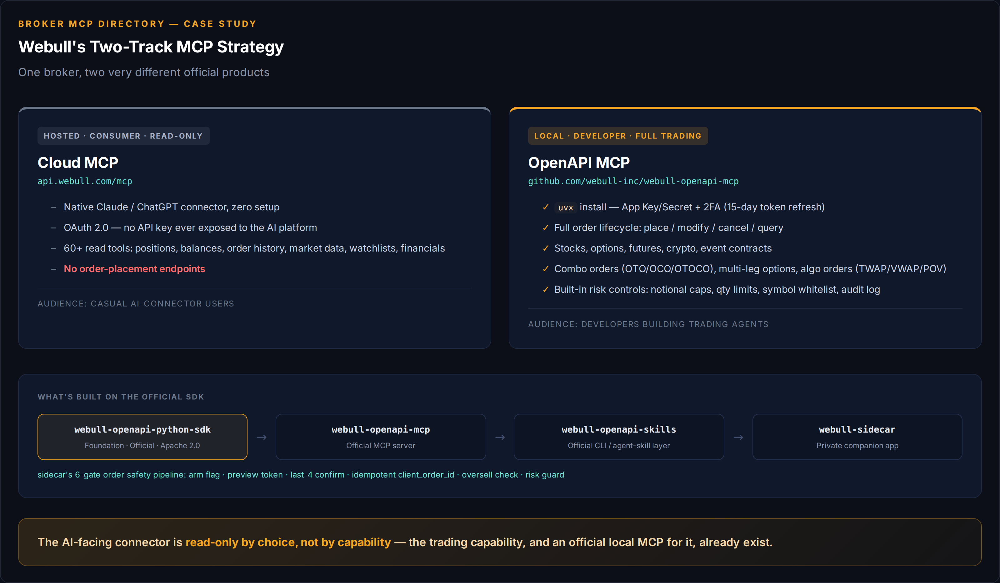
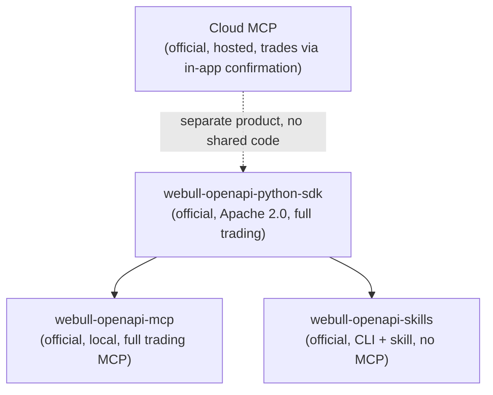

# Webull

Webull ships **two separate official MCP products**, aimed at different audiences.
Don't conflate them — they have opposite trading postures.



## 1. Cloud MCP: hosted, consumer, trade by instruction with in-app confirmation

The AI-connector-marketplace product: native Claude/ChatGPT integration, zero local
setup.

Hosted endpoint: `https://api.webull.com/mcp`

| Platform | Setup |
|---|---|
| Claude | Native integration via Claude Connectors |
| ChatGPT | Native integration via ChatGPT Apps |
| Codex | `codex mcp add webull --url https://api.webull.com/mcp` |
| Cursor | Settings → MCP Servers → Add Remote MCP Server |
| Zed | `settings.json` under `context_servers` |

**Auth**: OAuth 2.0 authorization-code flow, mobile/email + password + trading
password on Webull's own authorization page. No API key exposed to the AI platform.

**Trading scope**: **no longer read-only (changed since the 2026-07 check).** The
endpoint table at developer.webull.com now lists about 80 tools. Roughly 70 are
non-trading (account/position/balance, order history/status, market data for stocks,
futures, crypto and event contracts, watchlists, analyst
ratings, financials, fund data, dividend/earnings calendars). Ten are marked
**Trading**: `place_stock_instruction`, `place_option_single_instruction`,
`place_option_strategy_instruction`, `place_futures_instruction`,
`place_crypto_instruction`, `place_event_instruction`, `place_algo_instruction`,
`revoke_instruction`, `get_pending_instruction`, `get_processed_instruction`. Each
`place_*_instruction` tool is documented as *"requires confirmation in Webull APP /
Desktop"*: the agent creates a pending order instruction and the human confirms it in
Webull's own app. The agent cannot send a live order to the market on its own.

**Safety**: least-privilege. You choose which accounts and capability groups the agent
can see. The docs list four groups (Account Info, Order Query, Market Data, Security
Master); how the trading tools are authorized is not spelled out on that page.

Setup list also now includes Kiro and Cherry Studio, and the docs name Claude, ChatGPT
and Grok as AI marketplaces.

Source: [developer.webull.com](https://developer.webull.com/apis/docs/AI-friendly-Resources/mcp/)

## 2. OpenAPI MCP — local, developer, full trading

`github.com/webull-inc/webull-openapi-mcp` — published under Webull's own verified
GitHub org, built on their official `webull-openapi-python-sdk`. This is the one
with actual order placement.

**Connect**:
```
uvx webull-openapi-mcp auth    # interactive 2FA, approve in the Webull mobile app
uvx webull-openapi-mcp serve
```
App Key + App Secret from a regional Webull developer portal (developer.webull.com
for US, region-specific portals otherwise), set via env vars or `.env`. Tokens
auto-refresh; re-auth needed only after the 15-day expiry.

**Trading scope — full order lifecycle**: place, modify (`replace_*_order`), cancel,
query. Stocks, options, futures, crypto, event contracts. Combo orders
(OTO/OCO/OTOCO, US only), multi-leg options (US only), algo orders — TWAP, VWAP, POV
(US only). Region-specific order types and session validation apply. Single-leg option
and equity orders can leg into or out of an existing multi-leg position (US only,
added 2026-08/09). Order and `preview_*` tools exist for stocks, options and futures.
`WEBULL_TOOLSETS` (`account`, `market-data`, `trading`, `instrument`) lets you switch
the trading tools off entirely, server-side.

**Safety / guardrails**: **sandbox is the default.** `WEBULL_ENVIRONMENT` accepts `uat`
(sandbox) or `prod` and defaults to `uat`. The security section says so outright:
*"Default sandbox — The server defaults to UAT (sandbox) environment. You must
explicitly set `WEBULL_ENVIRONMENT=prod` for live trading."* The CLI repo
(`webull-openapi-cli`, Go) is a separate tool, not an MCP server. That puts Webull alongside [Alpaca](alpaca.md) and [Kraken](kraken.md) in the
small group that ships safe-by-default, and it's the kind of fact this directory should
lead with rather than omit.

Beyond that: notional limits by currency (`WEBULL_MAX_ORDER_NOTIONAL_USD` default
`10000`), max order quantity caps (`MAX_ORDER_QUANTITY` default `1000`), symbol
whitelist enforcement (`WEBULL_SYMBOL_WHITELIST`), and audit logging
(`WEBULL_AUDIT_LOG_FILE`) — all backed by `guards.py` / `audit.py` in the tree.

**Maintenance**: Apache 2.0, 28 stars, 45 commits, latest release v1.2.4 (2026-09-12),
last push 2026-09-12 (recent work: HK execution support, option leg-in/leg-out). The
README now lists regions US, HK, JP, SG, MY, UK, MX, BR, ZA, and pins `fastmcp` 3.0.2
and `webull-openapi-python-sdk` 3.0.0. Actively developed but a young project, not
battle-tested at scale. The earlier `webull-mcp-server` and `webull-agent-skills` repos
in the same org are archived (2026-06-02); use the current ones.

## 3. OpenAPI Skills and CLI: **no longer an MCP server**

`github.com/webull-inc/webull-openapi-skills`: an agent skill plus the `webull-skill`
CLI, built on the official SDK, same org. Apache 2.0, 12 stars, 33 commits, latest
release v1.2.1 (2026-09-12). It ships a Claude Code plugin manifest (added 2026-08).

**Correction:** earlier versions of this page said the repo was "both a CLI and an MCP
server" (its README once said *"This skill works as an MCP server"* with an `mcpServers`
config using `webull-skill mcp`). Verified 2026-10-12: that text was removed from the
README in v1.1.8 (commit 2026-07-28), the package's only entry point is
`webull_skill.cli:main`, and the tree has no MCP module. Treat it as a CLI/skill only.

CLI usage: `webull-skill auth`, `webull-skill trading --action account-list`, etc.
Multi-region, same asset-class coverage and risk controls (notional/quantity caps,
symbol whitelist, audit log) and the same sandbox-by-default posture (`WEBULL_ENVIRONMENT`
defaults to `uat`).

There is also `github.com/webull-inc/webull-openapi-cli`, a Go CLI marked "Alpha
Preview" (v1.0.4, 2026-09-12, 6 stars) with confirmation prompts and `--dry-run`. It is
a CLI, not an MCP server.

## How they relate



## Caveats

- Cloud MCP can now queue orders, but every order instruction needs a human tap in the
  Webull app or desktop. That is a strong guardrail, but it comes from Webull's docs
  only; not tested here with a live account.
- Full unattended trading requires the local `webull-openapi-mcp`, a young repo
  (28 stars). Keep it on `uat` until you have read `guards.py` and set the notional,
  quantity and whitelist limits yourself. Spot-check current state before real money.
- The Cloud MCP trading-capability authorization flow is not documented on the page
  checked; confirm it in the consent screen.

## Sources

Checked directly on 2026-10-12:

- <https://developer.webull.com/apis/docs/AI-friendly-Resources/mcp/> (Cloud MCP endpoint table)
- <https://github.com/webull-inc/webull-openapi-mcp> (README, releases, commits)
- <https://github.com/webull-inc/webull-openapi-skills> (cloned; README, pyproject, history)
- <https://github.com/webull-inc/webull-openapi-cli> (README, releases)
- <https://github.com/webull-inc> (org repo list and archive status)
